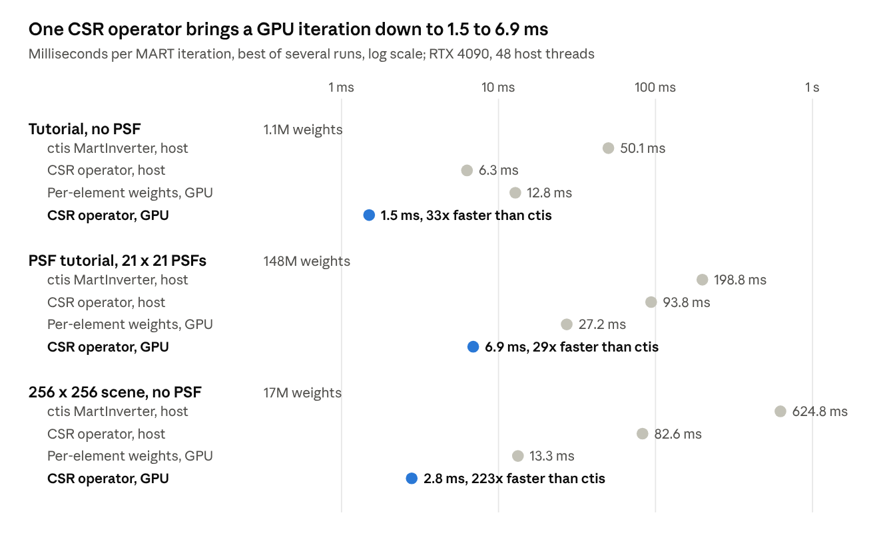
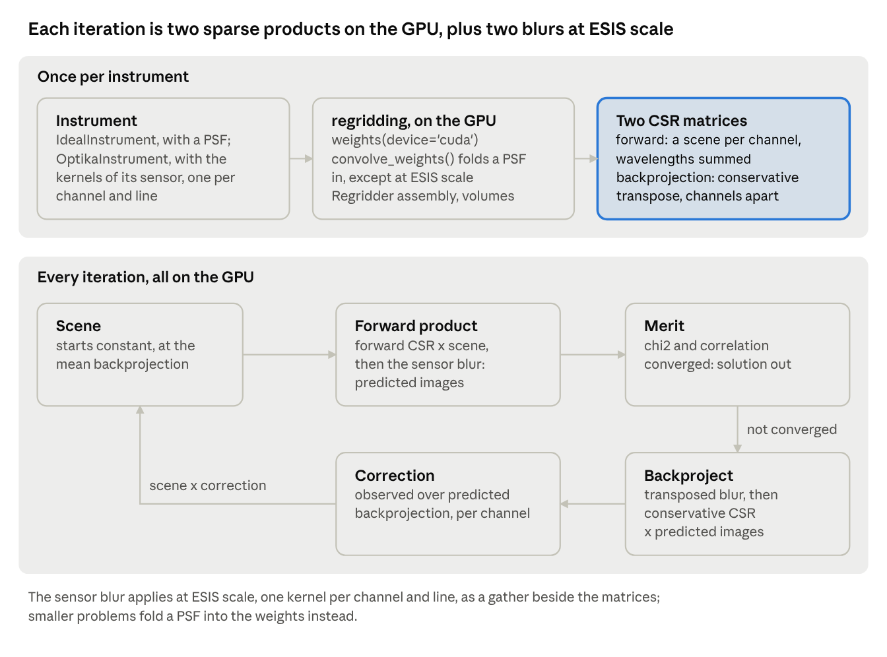
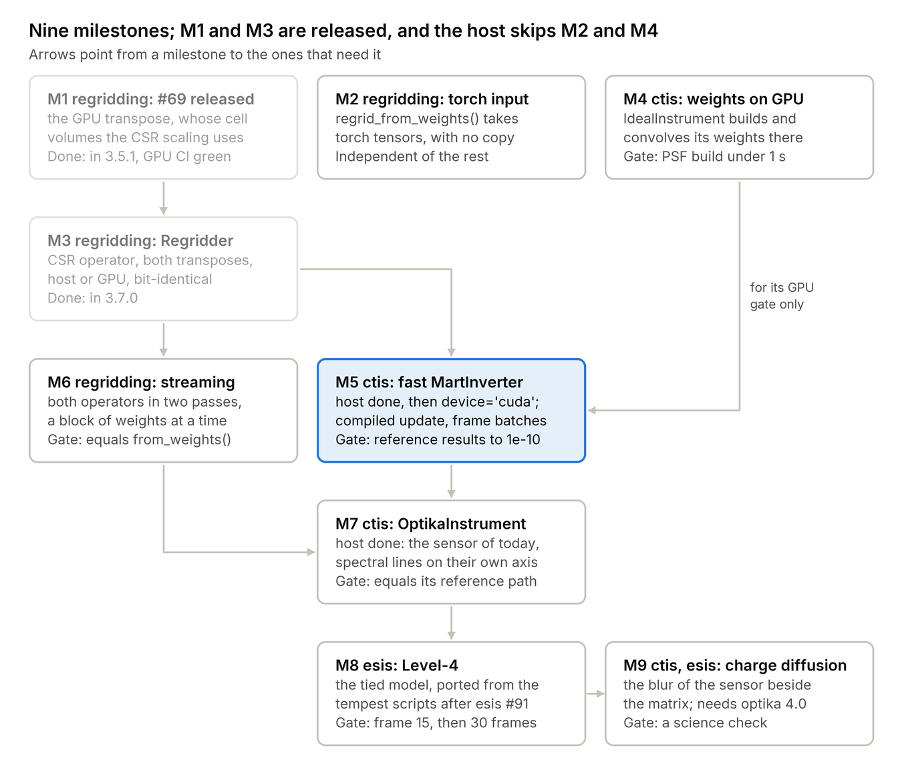

CPU and CUDA MART Roadmap
=========================

*As of 2026-11-13.*

Every numerical piece of a fast MART now exists,
and ``regridding.Regridder`` joins most of them:
one sparse CSR operator with both of its transposes,
assembled and applied on the host or on a GPU.
:class:`~ctis.inverters.MartInverter` now runs on it on the host,
for an :class:`~ctis.instruments.IdealInstrument`.
What remains is the same loop on a GPU and, for the ESIS Level-4 product,
the model of the flight instrument on the operator,
a streaming build for weights too large to hold at once
and the tied model of ESIS, which today lives in scripts.
The host comes first.
The production grid of ESIS needs about 48.5 GB,
which an 80 GB GPU holds and the 24 GB one of the workstation does not,
but which fits well within the 128 GB of its host,
so the host is where the product can be made and checked today.
The charge diffusion of the sensor, applied beside the matrix, follows with optika 4.0.

Where things stand
------------------

.. list-table::
    :header-rows: 1
    :widths: 22 22 18 38

    * - Piece
      - Where
      - Status
      - What it gives a fast MART
    * - Device weights, ``regridding.weights(device="cuda")``
      - regridding
      - Released
      - Conservative weights built on the GPU;
        the output grid must be a uniform, axis-aligned lattice
    * - ``regridding.convolve_weights()`` on the device
      - regridding 3.5.0
      - Released
      - A PSF folded into the weights without leaving the GPU
    * - ``regridding.regrid_from_weights()`` on the device
      - regridding
      - Released
      - Applies device weights, one kernel launch per orthogonal element;
        rejects ``torch`` tensors
    * - ``regridding.transpose_weights_conservative()`` on the device
      - `regridding #69 <https://github.com/sun-data/regridding/pull/69>`__
      - Released in 3.5.1 on 2026-10-08
      - Conservative transposes of device weights;
        its per-grid cell volumes give the CSR operator its conservative scaling
    * - ``regridding.Regridder``
      - `regridding #70 <https://github.com/sun-data/regridding/pull/70>`__
      - Released in 3.7.0 on 2026-11-13
      - Every channel and wavelength in one CSR matrix,
        with broadcasting declared by shapes, exact and conservative transposes,
        assembly on the host or GPU that agree bit for bit,
        and products in float32 where the matrix and the values both are
    * - :class:`~ctis.inverters.MartInverter`
      - ctis 0.5.0
      - Released
      - The reference algorithm, on the host through :mod:`named_arrays`,
        with PSF support in :class:`~ctis.instruments.IdealInstrument`
    * - :class:`~ctis.inverters.MartInverter` on the ``Regridder``
      - ctis main
      - Unreleased
      - The same algorithm on the host, on raw arrays and compiled code,
        for an :class:`~ctis.instruments.IdealInstrument`:
        frames solved together, float32 as an option,
        and the reference path kept for the instruments without matrices
    * - ``torch`` ``Regridder``
      - ctis ``feature/parametric-inverter``, ``feature/elastic-net-inverter``
      - Unmerged
      - Weights as one CSR matrix with an explicit transpose;
        its CUDA product is that of ``torch``, which does not repeat exactly on long rows;
        the ``Regridder`` of regridding generalizes it
    * - Device weights in optika, ``LinearSystem.weights(device="cuda")``
      - `optika #229 <https://github.com/sun-data/optika/pull/229>`__
      - Released in 3.1.0
      - The weights of an optical model built on the GPU;
        its distortion, vignetting and effective area are still prepared on the host
    * - Compiled polynomials, ``na.PolynomialFitFunctionArray``
      - `named-arrays #279 <https://github.com/sun-data/named-arrays/pull/279>`__
      - Released in 2.20.0 on 2026-11-12
      - That preparation in 3.3 s per spectral line of ESIS at production,
        instead of 28.1 s
    * - Sensor kernels, with charge diffusion
      - `optika #255 <https://github.com/sun-data/optika/pull/255>`__, for optika 4.0
      - Draft, unchanged since 2026-10-22
      - The blur of the noise-free sensor as a kernel per wavelength,
        its exact and scaled transposes, and a variance kernel for the noise model
    * - Level-4 GPU MART scripts
      - esis ``wip/level4-tempest-tooling``
      - Unmerged scripts
      - The production run: 30 frames in about 10 minutes on one H100,
        from CPU-built weights;
        the only home of the tied model of ESIS
    * - Distortion fit of the flight model
      - `esis #91 <https://github.com/esis-mission/esis/pull/91>`__
      - Open
      - The instrument a Level-4 model in the package is built from
    * - MART benchmarks
      - Local scripts
      - Throwaway
      - The MART loop of :class:`~ctis.inverters.MartInverter` on raw ``torch``
        tensors, with per-element device weights and with the CSR operator;
        both match the solution of ctis to 2e-14 of its peak

What we learned
---------------

One CSR operator makes a MART iteration on the GPU 29 to 223 times faster than ctis,
and 3.9 to 8.5 times faster than the per-element GPU path,
by replacing 160 kernel launches with two.
On the host alone it is 2.1 to 8 times faster than ctis.

    Milliseconds per MART iteration on an RTX 4090 and 48 host threads,
    for the tutorial, the PSF tutorial with 21 by 21 PSFs,
    and a 256 by 256 scene over 50 fixed iterations.
    All three ran back to back on 2026-10-12,
    with other applications keeping the GPU about 10% busy;
    each time is the best of 3 runs on the host and 5 on the GPU.
    Every implementation matched the solution of ctis to 2e-14 of its peak.

- **Launches dominate the GPU.**
  ``regrid_from_weights()`` launches one kernel per channel and wavelength,
  80 per regrid here, costing about 11 ms an iteration.
  The tempest scripts (one flat table per channel and ``index_add_``)
  and the ``torch`` ``Regridder`` (one CSR matrix) both avoid this.
- **Setup now dominates short runs.**
  On the PSF tutorial the CSR GPU path spends 2.7 s building its operators
  and 0.3 s iterating,
  so end to end it is 4.0 times faster than ctis,
  against 5.4 for the per-element path.
  Building the backprojection straight from the weights would remove
  one of its three assemblies and the transpose.
- **Short rows needed fewer threads.**
  The kernel gave every row a 32-thread warp,
  but without a PSF the rows of a backprojection hold about 3 entries each.
  It now gives each row as many threads as an average row has entries,
  rounded down to a power of two, up to a warp:
  2 for a backprojection without a PSF, that of ESIS included,
  and 32 for a forward operator or a backprojection with the 21 by 21 PSFs.
  At 256 by 256, the backprojection product went from 3.5 ms to under 0.5,
  against 0.6 to 0.7 for the sparse product of ``torch`` (cuSPARSE).
  Timed back to back, a MART iteration went from 6.1 ms to 2.8,
  against 2.7 for ``torch``;
  the gap left is about 0.2 ms of host time per product,
  which only small problems notice.
- **Assembly is cheap once parallel.**
  At 145M weights, assembling takes about 0.5 s on the GPU and on 48 host threads alike,
  and the transpose another 0.5 s.
  The host and GPU build the same matrix bit for bit.
- **Most of the host time of ctis is not regridding, except with large PSFs.**
  The same algorithm on raw arrays, with the same per-element regridding,
  takes 18 ms instead of 50 on the tutorial,
  and 247 instead of 628 on the 256 by 256 scene.
  The rest is :mod:`named_arrays` and :mod:`astropy` overhead:
  units, uncertain arrays, the residual correlation.
  On the PSF tutorial, where regridding 148M weights dominates,
  it takes 184 ms instead of 199.
- **At production scale the update must be compiled on the host.**
  At the size of the ESIS production grid,
  155M scene cells and four channels in float32,
  the update as ctis writes it in :mod:`numpy` takes 10.5 s an iteration on one thread,
  and one compiled pass over the same arrays takes 0.22 s.
  The products take about 2.3 s,
  scaled from a synthetic operator 14 times smaller.
- **Frames solved together share the matrix.**
  The host products are bound by memory traffic, most of it the matrix,
  which a batch of frames reads once.
  Four frames at once went through the forward product 2.1 times faster per frame,
  and through the backprojection 2.3 times.
- **The noise of the sensor changes between spectral lines, hardly within one.**
  In the model of the flight 1 sensor of ESIS in optika 3.9.0, an e2v CCD97 at -55 °C,
  an absorbed photon gives 3.75 electrons at He I 584 Å and 2.99 at O V 630 Å,
  and the variance-to-mean ratio of the signal falls from 2.34 to 2.04:
  25% and 14% across the lines of Level-4.
  Across ±200 km/s around one line they change by under 0.4% and by 0.2%.
  A forward product which keeps the lines apart
  can therefore give the variance from one ratio for each line.
  On the tutorial and the PSF tutorial, with their 20 wavelengths split into five lines
  of different yields, it gave the image and the variance of the reference path
  to 3e-15 of their peaks.
  Against an iteration with one yield, on the host,
  it took 1 to 3% longer on the PSF tutorial, 12 to 16% on the 256 by 256 scene,
  and about a quarter on the tutorial, as much as a second product does there.
  A second product, which a ratio for each wavelength needs,
  took from a quarter longer on the tutorial
  to between a half and two thirds longer on the PSF tutorial.
- **Building the weights was the expensive step at production scale.**
  Tempest needed about 1.3 TB of cached CPU weights and 1.2 TB jobs per frame.
  Built on the GPU, the 148M weights of the PSF tutorial and their transpose
  take 0.95 s instead of 2.7 s.
  On the host, the weights of one spectral line of ESIS at production
  now take 18.5 s and need no cache;
  see `Regenerate or cache`_.
- **The scaling of the backprojection cancels in MART.**
  The adjoint of the ``torch`` ``Regridder`` is the exact transpose,
  and the backprojection of ctis is the conservative one:
  the exact transpose with each entry scaled by an input-cell factor
  over an output-cell volume, so both share one set of indices.
  MART divides the backprojection of the observed images by that of the predicted ones,
  so on a uniform pixel grid a factor on each scene cell cancels.
  With the exact transpose in place of the conservative one,
  the corrections agreed to 7e-16
  where the two backprojections differed by factors of 0.4 to 10.
  The scaling matters only to the first guess, which ctis takes from the backprojection,
  and to spectral lines tied in one window,
  where it sets how the lines are weighted against each other.
- **Atomic adds are not deterministic.**
  The device scatter adds in no fixed order,
  and the ratios of MART amplified that to 1e-10 where both sides are near zero.
  CSR gives identical results every run.
- **The sparse product of** ``torch`` **does not repeat exactly either.**
  On rows of 4,500 entries, all 100 repeated products differed,
  by 1 to 4 ulp in about half the values,
  even under ``torch.use_deterministic_algorithms(True)``.
  Short rows repeat, but the result for a column changes with the batch width.
  The kernel of the regridding ``Regridder`` repeats exactly in every case.
  The docstring of the ``torch`` ``Regridder`` in ctis calls its product
  bitwise deterministic on CUDA, which is wrong for long rows.
- **Precision and memory trade off.**
  Tempest stored values as float32 and indices as int32
  to fit the production grid on one 80 GB GPU.
  The benchmarks used float64 throughout to match ctis exactly.
  Measured, the CSR operator stores 12 bytes per weight per direction in float64
  and 8 in float32.
- **The GPU must be quiet to benchmark.**
  On the PSF tutorial the per-element path took 21 ms an iteration on a quiet GPU,
  27 ms with other applications keeping it about 10% busy,
  and 57 ms with video apps open.
  Single runs on a shared GPU varied by up to 30%,
  so the figure reports the best of several.
- **Stopping rules differ, and so do exponents and first guesses.**
  The PSF tutorial stops at the first :math:`\langle \chi^2 \rangle \leq 1`;
  tempest stops when :math:`\langle \chi^2 \rangle` improves by less than 1e-2;
  ctis stops when it improves by less than 1e-3.
  ctis raises each correction to :math:`\gamma = 2 / N` for :math:`N` channels
  unless told otherwise, where tempest uses :math:`\gamma = 1`.
  ctis starts from a constant scene,
  and tempest from a Gaussian line profile inside the field stop,
  scaled to the observed images.

Design
------

The fast MART is :class:`~ctis.inverters.MartInverter` running on ``regridding.Regridder``:
two sparse CSR matrices, the forward model and a conservative transpose for the backprojection,
assembled where they are applied, on the host or on a GPU.
On a GPU the weights of regridding are built there too,
and only the merit, one number per channel, returns to the host each iteration,
until the solution does.

    Build once, then a five-step loop, drawn here on a GPU.
    The host runs the same loop on arrays in its own memory.

The loop is the algorithm of ctis unchanged;
only the two products, the arrays it runs on and where they live differ.
Today's loop through :mod:`named_arrays` stays as the reference path,
which every gate compares against.

- **Operators as CSR, in regridding.**
  ``regridding.Regridder`` holds every channel and wavelength in one matrix,
  assembled from the weights of regridding where they were built:
  on a GPU, with the ``-1`` slots dropped and no round trip through the host.
  Each row sums in a fixed order,
  so the host and GPU build the same matrix bit for bit,
  and an iteration is two launches instead of 160.
  Each row is summed by as many GPU threads as an average row has entries,
  rounded down to a power of two, up to a warp,
  so the short rows of a backprojection no longer waste most of a warp.
- **Broadcasting declared by shapes.**
  The operator takes the shapes of the values going in and coming out.
  Where the weights vary along an axis,
  a length of 1 in the input means broadcast inside the matrix,
  and a length of 1 in the output means summed.
  Axes the weights lack are batch columns.
  The forward model is one product from (channel, wavelength, x, y) to (channel, x′, y′),
  on a scene for each channel:
  the scene times the photons that each of its units sends toward that channel,
  which one compiled pass writes.
  MART backprojects each channel on its own,
  so the backprojection is the conservative transpose of that same operator,
  derived the first time it is needed,
  and only one operator is assembled from the weights.
  An operator which shared the scene between the channels would save that pass,
  but its transpose would sum the channels,
  so the backprojection would need a second assembly.
- **Conservative values on the indices of the transpose.**
  The conservative transpose scales each entry of the exact one
  by an input-cell factor over an output-cell volume,
  taken from the element of the weights the entry came from.
  For the backprojection of MART, whose columns keep the channels apart,
  scaling the rows and columns would do the same;
  the ``Regridder`` scales each entry,
  so that the transpose of an operator sharing its input across channels is right too.
  Each entry is scaled once at build time.
  MART needs no exact values,
  so its backprojection stores only the conservative ones:
  4 bytes per entry in float32.
  A gradient inverter needs the exact values instead.
  Since the scaling cancels in the corrections of MART,
  the exact values would serve it as well wherever no lines are tied;
  the conservative ones are kept because the first guess of ctis is a backprojection too.
- **Inside** :class:`~ctis.inverters.MartInverter`\ **, on the host first.**
  The fast path runs the loop on raw arrays with the two products of the ``Regridder``,
  on the host or, behind a ``device`` option, on a GPU.
  The update rule and stopping tests stay those of the reference path.
  :mod:`named_arrays` stays at the boundaries:
  images in, a :class:`~named_arrays.FunctionArray` solution out.
  On the host the update is one compiled pass over the scene,
  since in :mod:`numpy` it would take more than four times as long as the products
  at production.
- **Frames in batches.**
  One pair of operators serves every frame of a flight,
  and the ``Regridder`` applies its matrix along a batch axis,
  so several frames are solved at once and share each pass over the matrix.
  Each frame stops at its own iteration, as it would alone,
  and a product does not depend on the width of its batch,
  so a batch gives the solutions the frames would have had one at a time.
  On the host, the production operators and the arrays of four frames take about 73 GB.
- **float64 by default, float32 as an option.**
  float64 matches the reference path to rounding.
  float32 cuts each stored weight from 12 to 8 bytes per direction,
  and the arrays of MART by half,
  which the ESIS production grid needs.
  Each row still sums in float64.
  A product is float32 only where the matrix and the values both are,
  so the arrays of MART at production take 8.1 GB instead of 16.2.
  Column indices are int32 whenever the matrix has fewer than :math:`2^{31}` columns.
- **The noise model of the instrument.**
  :class:`~ctis.instruments.IdealInstrument` gets shot plus read noise,
  as on the reference path.
  :class:`~ctis.instruments.OptikaInstrument` gets the model of its sensor
  in two steps.
  In M7 it is a gain for each channel and wavelength,
  and a variance-to-mean ratio for each channel and spectral line,
  both read from the sensor model of today instead of measured with a noise probe.
  The gain folds into the forward values, so the image is that of the reference path.
  The ratio changes by 14% across the lines of ESIS but by 0.2% within one,
  so one ratio serves a line, to about 0.1%.
  The forward matrix keeps the lines apart, as described below,
  and the variance of an image is the sum of the images of its lines,
  each times its ratio:
  one product gives the image and its variance.
  Tempest keeps a ratio for each wavelength,
  which needs a second product in every iteration.
  In M9, from optika 4.0, the sensor publishes kernels,
  and the variance of a line is its variance kernel convolved with its photon image:
  still one product, and one more convolution for each line.
  The variance kernel starts as the variance-to-mean ratio times the kernel
  and can become exact later behind the same interface.
- **Streaming two-pass assembly at ESIS scale.**
  The production weights are 35 to 53 GB on the device,
  more than any GPU holds beside the matrix,
  and on the host they take at least as much memory again as the matrices they build.
  A builder takes them a block at a time, twice:
  the first pass counts the entries of each row, which fixes the size of the matrices,
  and the second places them.
  Both operators come from the one stream,
  since the conservative values of a block need its grids,
  which exist only while the block does.
  Exact zeros, which the field stop leaves behind, are dropped:
  a third of the weights of a spectral line at production.
  Each block carries an explicit row and column offset and a scale,
  so the tied lines of ESIS fold into their windows,
  and a separate factor for the backprojection,
  which sets how tied lines are weighted against each other.
  The first pass cannot be skipped.
  The counting pass of the clipping kernel gives only an upper bound,
  1.5 to 1.8 times the entries kept,
  so exact sizes need the weights themselves.
- **Blurs on the pixel grid beside the matrix, at ESIS scale.**
  From optika 4.0, the noise-free model of a sensor includes charge diffusion:
  the expected image is the photon image convolved, per wavelength, with a small kernel.
  Folding that kernel into the weights, as ``convolve_weights()`` does for the PSF tutorial,
  would grow the 3.5 pixels each scene cell touches at production
  to about :math:`(\sqrt{3.5} + k - 1)^2` for a k by k kernel.
  With the slab model of the e2v CCD97 in optika #255,
  the 15 µm pixels of ESIS need 9 by 9 to hold all but 1e-6 of the charge
  (5 by 5 leaves out 5e-4),
  and the default kernel of the sensor is 11 by 11:
  28 to 40 times the entries.
  The forward matrix would grow from 17.7 GB to 490 to 710 GB in float32.
  Instead, the forward product is followed by the blur,
  and the backprojection starts with its transpose:
  two more launches an iteration, and no stored weights.
  The blur is a gather, each pixel summing its neighbors in a fixed order,
  so it repeats exactly like the products.
  The sensor supplies both of its transposes, as the ``Regridder`` does:
  the exact one for gradient inverters and the scaled one for MART.
  An optical PSF of ESIS, if one is added, goes the same way.
- **Spectral lines on their own axis, at ESIS scale.**
  The noise of the sensor and, from optika 4.0, its diffusion kernel
  depend on wavelength, but the forward product sums over it.
  Both change from one line to the next and hardly within one.
  For the e2v CCD97 of optika #255 with 15 µm pixels,
  the gain falls by a quarter across 580 to 640 Å,
  but the shape of the kernel changes little:
  by up to 1.1e-4, 0.11% of a nearest-neighbor value,
  which moves 2.3e-4 of the charge,
  and within the ±210 km/s window of one line it moves under 3e-6.
  So the scene of ESIS keeps each line on its own axis,
  and the forward matrix sums only within a line.
  What depends on the line is applied to its image before the lines are summed:
  from M7 its variance-to-mean ratio, which gives the variance without a second product,
  and from M9 one kernel per channel and line, which blurs it.
  The shape rules of the ``Regridder`` need nothing new for this.
  The gain of each wavelength folds into the forward values,
  and its inverse into the conservative ones,
  so the image matches the per-wavelength model of :mod:`optika` to a few parts in a million,
  and its variance to about 0.1%.
  At production this costs about 0.5 GB of row pointers and 0.25 GB of intermediate images.
- **Not chosen: a single-launch scatter, or a second matrix of transposed weights.**
  The scatter would remove the launch overhead but stay nondeterministic;
  CSR removes both.
  A second matrix would repeat the indices of the transpose,
  when only its values differ.
- **Not chosen: the sparse product of** ``torch`` **(cuSPARSE).**
  Its results do not repeat exactly on long rows,
  even in the deterministic mode of ``torch``,
  and change with the batch width.
  It cannot sum float32 entries in float64,
  and its 64-bit row pointers force 64-bit column indices,
  8.8 GB more per direction at ESIS scale.
  Our kernel now takes less time than it for the two products of MART together,
  from 17M weights up.

Milestones
----------

Nine milestones take the fast MART from prototype to the ESIS Level-4 product,
on the host first and then on a GPU.
M5 is the first one users can run, and its host half is done:
:class:`~ctis.inverters.MartInverter` runs on the ``Regridder`` on the host,
and the ``device`` option, for a GPU, remains.
M1 shipped in regridding 3.5.1 and M3 in regridding 3.7.0, which M5 and M6 need.
M2 and M4 can start now, and the host needs neither.

    Milestones M1 to M9, with the gate under the name.
    Arrows point from a milestone to the ones that need it.
    Each is one pull request, except M8, which is several.

The path of the host is M3, M5, M6, M7 and M8.
M4 only speeds up the build of the weights on a GPU,
so M5 needs it for its GPU gate alone.
M2 is off the path of MART, since the loop uses CSR products
rather than ``regrid_from_weights()``;
it fixes the ``torch`` bug the benchmark found.
The GPU transpose kernel of #69 is off the path too,
because the operator scales its own transpose,
but the cell-volume code of #69 is what that scaling uses.
M3 should be reviewed by the author of the ``torch`` ``Regridder``,
which it generalizes.
M6 builds the operators from blocks of weights produced on demand,
since the production weights fit beside the matrices on no GPU,
and on the host only barely.
M7 no longer waits for optika 4.0.
It reads the gain of each wavelength and the noise of each spectral line
from the sensor model of today,
keeps the lines on their own axis,
and its gate is one that ctis can run by itself.
The comparison of frame 15 with tempest moves to M8,
since it needs the tied model of ESIS, which only M8 builds.
M8 is a port of the tempest scripts.
It no longer waits for esis #70,
which holds the untied model on a base that esis #91 superseded,
while the distributed product used the tied one.
M9 is new: the charge diffusion of the sensor, which needs optika 4.0,
is added once the product of tempest is reproduced without it.

Validation and benchmarks
-------------------------

Every milestone is proven against the path it replaces,
on the host first and then on a GPU, and timed on an idle machine.
The reference path, today's :class:`~ctis.inverters.MartInverter` through :mod:`named_arrays`,
is the standard throughout, since it is already validated.
At ESIS scale, where it cannot run, the standard is the product of tempest.

.. list-table::
    :header-rows: 1
    :widths: 10 50 40

    * - Milestone
      - Correct when
      - Fast when
    * - M1
      - The device tests of #69 pass on the GPU runner of regridding
      - Device transpose at or under 166 ms for 35M weights
    * - M2
      - A ``torch`` tensor resamples to the same result as a :mod:`numpy` array,
        with no copy
      - No target
    * - M3
      - Block-diagonal products equal ``regrid_from_weights()``
        and the conservative transpose equals ``transpose_weights_conservative()``,
        bit for bit; GPU assembly equals host assembly;
        a float32 matrix applied to float32 values returns float32.
        All four pass
      - One launch per product;
        the two products together no slower than cuSPARSE from 17M weights up;
        assembly in about 0.5 s per 145M weights.
        It met all three as a draft
    * - M4
      - Device weights match the host weights to 1e-12 in float64,
        compared as dense matrices once the ``-1`` slots are dropped,
        as the device tests of regridding compare them
      - The weights of the PSF tutorial and their transpose in under 1 s (0.95 s in the prototype)
    * - M5
      - On the host and on a GPU, in float64:
        the same iteration count as the reference path,
        and :math:`\langle \chi^2 \rangle` and the solution within 1e-10 of its,
        on all three benchmark problems.
        In float32, the same iteration count,
        and :math:`\langle \chi^2 \rangle` and the solution within 1e-5.
        A batch of frames gives the solutions of the frames solved one at a time,
        bit for bit.
        The host passes all three:
        on the benchmark problems its solutions agree with those of the reference path
        to 1.5e-14 of their peaks in float64 and to 2.3e-7 in float32,
        at the same iteration counts
      - On the host, the loop outside the two products takes less time than they do
        at the production size of ESIS.
        On a GPU, at least 6 times faster end to end on the PSF tutorial
    * - M6
      - On weights that fit, the streamed build equals ``Regridder.from_weights()``
        bit for bit once the exact zeros are dropped from both,
        for the forward operator and for the backprojection;
        each block's count agrees between the two passes
      - The production build, weights included,
        in under 10 minutes on the host and within the memory of a 128 GB workstation.
        Production assembly, beyond building the weights,
        in under a minute on an 80 GB GPU
    * - M7
      - On a grid of ESIS that fits both, with no lines tied,
        the fast path gives the images and, at a fixed iteration count, the solution
        of the reference :class:`~ctis.instruments.OptikaInstrument`
        within 1e-10 in float64,
        and within the tolerance of M5 in float32.
        Its variance agrees with that of the reference to 2e-3,
        since it takes one variance-to-mean ratio for each line
      - The weights of one spectral line of ESIS at production
        in under 20 s on the host and under 10 s on a GPU
    * - M8
      - Frame 15 on a coarse grid, on one model of the instrument
        and at a fixed iteration count,
        matches ``reproduce_level4.py`` of tempest
        within a tolerance agreed before the run.
        Then the 30-frame cube at production is compared
        with the distributed Level-4 FITS files, each frame at its recorded iteration count,
        and the differences are reported beside what has changed in the model since
      - The 30 frames at production in under an hour on the host.
        On an 80 GB GPU, no slower than tempest,
        which ran them in about 10 minutes on an H100
    * - M9
      - With ``diffusion=None`` on the material of the sensor, M8 unchanged;
        with diffusion on, a science check
      - Two more launches an iteration on a GPU, and no stored weights

The benchmark problems are the tutorial, the PSF tutorial and the 256 by 256 scene.
The host gates need no new CI.
ctis needs a GPU CI job before M4,
like the ``tests-cuda`` workflow of regridding,
which runs on the runner the ``GPU_RUNNER`` variable names.

Comparisons with tempest are made at a fixed iteration count.
Its loop stops on a change of 1e-2 in :math:`\langle \chi^2 \rangle`,
which rounding can move by an iteration,
so each frame is compared at the count recorded for it.
Its loop is also not the default of ctis, in exponent, threshold and first guess,
so M8 sets all three explicitly.

Memory at ESIS scale
--------------------

The ESIS production grid, 0.75″ pitch and 24 velocity bins,
needs about 48.5 GB in float32:
it fits an 80 GB GPU, not a 24 GB one,
and it fits the host of a 128 GB workstation,
with room for four frames at once at about 73 GB.
Only the production row is measured, by the count of tempest of 2.21 billion weights;
the others scale it by grid.
Today's model is consistent with that count:
one spectral line built with optika 3.9.0 holds 312 million weights that are not zero,
which over seven lines like it is about 2.2 billion.

.. list-table::
    :header-rows: 1

    * - Grid
      - Weights per direction
      - Forward (GB)
      - Backprojection (GB)
      - MART arrays (GB)
      - Total, float32 (GB)
      - Total, float64 (GB)
    * - 0.75″, 24 bins (production)
      - 2.21 billion
      - 17.7
      - 22.7
      - 8.1
      - 48.5
      - 74
    * - 1.0″, 24 bins
      - 1.72 billion
      - 13.8
      - 16.6
      - 4.6
      - 35.0
      - 53
    * - 0.75″, 14 bins
      - 1.29 billion
      - 10.4
      - 13.2
      - 4.7
      - 28.3
      - 43
    * - 1.5″, 24 bins
      - 1.29 billion
      - 10.4
      - 11.6
      - 2.0
      - 24.0
      - 36
    * - 1.0″, 14 bins
      - 1.00 billion
      - 8.1
      - 9.7
      - 2.7
      - 20.4
      - 31
    * - 1.5″, 14 bins
      - 0.75 billion
      - 6.1
      - 6.8
      - 1.2
      - 14.0
      - 21

The costs are measured: 8 bytes per weight per direction in float32,
12 in float64, plus 8 per row.
The backprojection stores only the conservative values MART uses;
keeping the exact ones beside them would add 8.8 GB at production in float32.
The arrays of MART are counted in float32,
which the products of the ``Regridder`` now read and return.
The backprojection keeps each channel apart,
so at production it has 623M rows, whose pointers alone take 5 GB.
The scene is 1139 cells across at 0.75″,
from the raytrace field of the distortion fit padded by 1.25, as tempest builds it.
Fewer velocity bins shrink the problem most;
coarser cells help less, since each one touches more detector pixels.
Keeping the spectral lines on their own axis,
for the noise of the sensor from M7 and its blur from M9,
adds about 0.75 GB at production.

Regenerate or cache
-------------------

The streamed build needs every block of weights twice.
Rebuilding them is now cheap enough to keep no cache:
about 5 minutes a run on the host and 2 on a GPU,
with nothing to store,
and nothing to invalidate when the optics, the grids or the code change.

What made rebuilding slow was the host-side preparation in :mod:`optika`,
which distorts every vertex of the scene and evaluates the vignetting of every cell:
22.2 s per spectral line when first timed, and 28.1 s on 2026-11-12,
nearly all of it arithmetic on one thread over arrays of 124 million points.
From :mod:`named_arrays` 2.20.0 a compiled kernel evaluates those polynomials,
and the preparation takes 3.3 s.
Building the weights is now most of a line on the host.

.. list-table::
    :header-rows: 1
    :widths: 52 24 24

    * - Step, for one spectral line at production
      - named-arrays 2.18.0
      - named-arrays 2.20.0
    * - Distortion
      - 17.1 s
      - 1.3 s
    * - Vignetting
      - 10.3 s
      - 1.2 s
    * - Field stop, effective area and their product
      - 0.8 s
      - 0.9 s
    * - Preparation in :mod:`optika`, in all
      - 28.1 s
      - 3.3 s
    * - Weights on the host
      - 15.8 s
      - 15.2 s
    * - Transposed weights of :mod:`optika`, which repeat the preparation
        and which the operator replaces with its own conservative transpose
      - 36.6 s
      - 9.4 s

.. list-table::
    :header-rows: 1
    :widths: 44 22 34

    * - Way to supply every block twice
      - Per run, production grid
      - Needs
    * - Rebuild everything each pass, on the host
      - About 5 minutes
      - Nothing extra
    * - Rebuild everything each pass, on a GPU
      - About 2 minutes
      - Nothing extra
    * - Disk cache of the compacted forward weights
      - 38 s
      - 26.5 GB of NVMe, built once and rebuilt whenever its inputs change

The rates are measured for one spectral line (four channels, 24 velocity bins)
on the flight 1 model of ESIS, and scaled to its seven lines.
Those of the host were timed on 2026-11-12, on 48 threads,
with optika 3.9.0 and regridding 3.6.0:
18.5 s a line, so 4.3 minutes for both passes.
The GPU build, 3.2 s for the 557M slots of a line on an RTX 4090,
and the disk cache, on an NVMe SSD reading 3.0 GB/s
with pinned copies between host and GPU at 13 GB/s,
were timed in October;
with the preparation of today a line takes 6.5 s on a GPU, so 1.5 minutes for both passes.
Assembly adds 16 s on a GPU and,
scaled from a matrix 14 times smaller, about half a minute on the host.
Linearizing the optics takes another 6 s per line once, which esis already caches.

Risks and open questions
------------------------

GPU memory is the main risk on a GPU, and the reason the host comes first.
On the host the main risk is the comparison with tempest,
whose model of the instrument has since moved.
The rest are questions to settle before the milestone that needs them.

- **GPU memory (M6, M8).**
  The ESIS production grid needs about 48.5 GB in float32,
  so an 80 GB GPU like the H100 tempest used.
  A 24 GB card fits 14 velocity bins at 1.0″ only tightly;
  see `Memory at ESIS scale`_.
  Moving the operators of one channel at a time onto a 24 GB card does not help:
  the copies alone would take about 3 s an iteration,
  more than the products take on the host.
- **The model of the instrument has moved since tempest (M8).**
  The distributed product was made in August with optika 2.1.0.
  Since then the quantum efficiency of the sensor has changed,
  from 30% to 28% at O V between optika 3.7 and 3.9 alone,
  and the distortion of the flight model has been fitted again in esis #91.
  A run on today's model cannot match the FITS files to rounding, whatever the code.
  So M8 has two gates:
  the new code against the script of tempest on one model and a coarse grid,
  held to a tight tolerance,
  and the production cube against the FITS files,
  with the differences reported beside these changes.
  The first needs the script of tempest to run on today's versions, which is unchecked.
- **The time of MART on the host is extrapolated (M5, M8).**
  The products at production are scaled from a synthetic operator 14 times smaller:
  about 2.3 s an iteration,
  so about 25 minutes for the 30 frames one at a time,
  and about 12 in batches of four.
  Neither has been run.
- **A** ``device`` **option or a separate inverter (M5).**
  The design assumes the fast path goes inside :class:`~ctis.inverters.MartInverter`,
  on a GPU behind a ``device`` option, rather than in a separate inverter.
  On the host this is settled:
  the fast path is what :class:`~ctis.inverters.MartInverter` runs
  whenever the instrument provides its matrices,
  and the reference path serves the instruments which cannot, and the tests.
  The ``device`` option is still to come.
- **The width of a batch of frames (M8).**
  :class:`~ctis.inverters.MartInverter` solves every frame of the images it is given at once.
  At production four frames fit in the host, not thirty,
  so either the caller passes four at a time, or the inverter takes a limit.
- **Regenerate or cache (resolved).**
  Rebuild.
  Since :mod:`named_arrays` 2.20.0 the preparation in :mod:`optika`
  takes 3.3 s per spectral line instead of 28.1,
  and a run builds every block twice in about 5 minutes on the host,
  with nothing to store or invalidate.
  See `Regenerate or cache`_.
- **Sorting for CSR (resolved).**
  The ``Regridder`` sorts one block of weights at a time
  and places it at the cursors of its rows,
  so assembly needs one block's sort beyond the matrix, not a second copy of it.
- **optika weights on the GPU (M7).**
  The device clipping needs a uniform, axis-aligned output lattice,
  which the pixel grid of a sensor is,
  and from optika 3.1.0 ``LinearSystem.weights()`` takes a ``device``
  and passes it to ``named_arrays.regridding.weights()``
  (`optika #229 <https://github.com/sun-data/optika/pull/229>`__).
  ctis allows optika 3.1,
  so :class:`~ctis.instruments.OptikaInstrument` needs only to pass its device on.
  The distortion, vignetting and effective area are still prepared on the host,
  now in 3.3 s per spectral line at production;
  see `Regenerate or cache`_.
- **named-arrays cannot hold device arrays.**
  The GPU path converts at its boundaries, which costs little.
  A ``torch`` backend for :mod:`named_arrays` would remove that,
  but is a far larger project.
- **Which stopping rule (M5).**
  The fast path should keep that of the reference path:
  today ctis stops when :math:`\langle \chi^2 \rangle` improves by less than 1e-3.
  Tempest used 1e-2, and the PSF tutorial stops at :math:`\langle \chi^2 \rangle \leq 1`.
- **Coordination (M3, M8).**
  M3 generalizes the ``torch`` ``Regridder`` of a teammate,
  and M8 ports the tempest scripts of the same teammate.
  M3 needs that teammate's review,
  and the ownership of M8 needs agreeing before it starts.
- **How tied lines are weighted (M6, M8).**
  The weights of a tied line fold into the columns of its window with a fixed ratio,
  which the offsets and the scale of a block express.
  The backprojection is the open part.
  Tempest blends the conservative transposes of the lines of a window,
  each by its share of the flux of the window,
  a total known only once every block has been built once.
  The conservative transpose of the tied forward operator would weight them otherwise,
  and the ``Regridder`` refuses to form it,
  since an entry summed over lines no longer says which line it came from.
  The scaling of a backprojection otherwise cancels in MART,
  so this weighting is the one choice in its values that changes the solution.
  The builder of M6 therefore takes a factor for the backprojection with each block,
  apart from the scale of the forward operator,
  and M8 gives it the shares of tempest, found in the first pass.
  The loop over lines stays on the esis side,
  so regridding knows nothing of ESIS.
- **GPU-built weights differ slightly (M4, M5, M7, M8).**
  The GPU clipping keeps a few tiny overlaps the CPU build drops,
  under 1e-12 in the device tests of regridding.
  So M4, M5 and M7 compare to a tolerance,
  and a GPU-built Level-4 run will match neither tempest's nor the host's bit for bit:
  M8 needs a tolerance agreed before the run.
- **The second product of the noise model (resolved).**
  None is needed.
  A variance-to-mean ratio for each wavelength needs a second forward product,
  and tempest stores a second values array for it on the forward indices:
  8.8 GB at production in float32,
  beyond the 48.5 GB of `Memory at ESIS scale`_,
  and a quarter to two thirds more time for each iteration of the benchmark problems.
  The ratio changes by 0.2% within a spectral line,
  so with the lines on their own axis one ratio for each channel and line
  multiplies the image of that line, after the one product.
  See `Design`_.
- **How an instrument names its spectral lines (M7).**
  Keeping the lines apart needs the instrument to say
  which wavelengths belong to which line.
  The reference :class:`~ctis.instruments.OptikaInstrument` has one wavelength axis,
  and so does :class:`~ctis.instruments.IdealInstrument`,
  where the fast path supports one line,
  with a quantum yield which does not vary with wavelength.
  An axis for the lines in the coordinates of the scene, named explicitly,
  is the leading option, and it is new public API to agree before M7 starts.
- **Charge diffusion changes Level-4 (M9).**
  From optika 4.0, the noise-free model of a sensor includes charge diffusion,
  so MART will also undo the diffusion blur,
  and Level-4 reconstructions will differ from those of tempest.
  ctis allows only optika below 4, so nothing changes until ctis raises that cap.
  M8 therefore reproduces tempest on optika 3, without diffusion,
  and M9 adds it and checks the science.
  optika 4.0 waits on a stack of four open pull requests, #244, #251, #255 and #256,
  the last three drafts, and none has changed since 2026-10-22.
- **Host time per GPU call (M5).**
  Each ``Regridder`` call spends about 0.2 ms on the host,
  in the launch of ``numba``, its array wrappers and the layout in ``torch``.
  That is why ``torch`` still wins a whole iteration on small problems:
  timed back to back, 0.9 ms against 1.1 on the tutorial,
  and 2.7 against 2.8 at 256 by 256.
  Launching without the wrappers of ``numba`` could cut it;
  at ESIS scale it is negligible.
